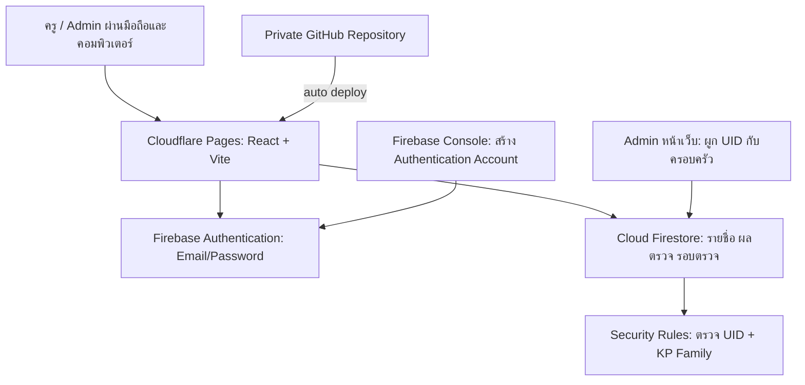
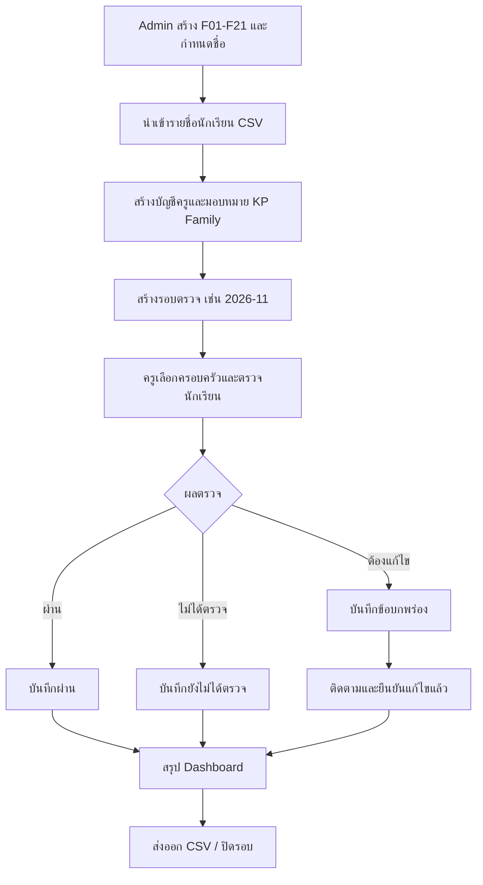

# แบบออกแบบระบบ KP Smart Uniform Inspection

**โรงเรียนคีรีราษฎร์พัฒนา · MVP 0.1**

## วัตถุประสงค์

ตรวจเครื่องแต่งกายนักเรียนรายเดือนตาม KP Family ลดภาระครูผู้ตรวจ บันทึกผลตรวจรายบุคคลตามรอบ และติดตามการแก้ไขโดยไม่ซ้ำกับระบบการเช็คชื่อเข้าเรียนและระบบคะแนนพฤติกรรม.

## ภาพรวมสถาปัตยกรรม

### สิทธิ์การเข้าถึง

| ส่วนข้อมูล | Admin | ครูผู้ตรวจ |
|---|---|---|
| `users` | อ่าน/จัดการครู (role=teacher) | อ่านเฉพาะ profile ตนเอง |
| `families` | ทุกครอบครัว + แก้ไข | อ่านเฉพาะที่ได้รับมอบหมาย |
| `students` | ทุกคน + นำเข้า | อ่านเฉพาะ familyId ที่มอบหมาย |
| `inspection_rounds` | อ่าน/เพิ่ม/แก้ไข | อ่านอย่างเดียว |
| `inspections` | อ่าน/บันทึกทั้งหมด | อ่าน/บันทึกครอบครัวตนเอง ขณะเปิดรอบ |
| `inspection_events` | อ่านทั้งหมด | อ่านของครอบครัวตนเอง; เพิ่ม log พร้อมบันทึกผลตรวจเท่านั้น |

Admin คนแรกต้อง bootstrap ทาง Firebase Console. การกำหนดครูจากหน้า Admin ผูก UID ที่มีอยู่แล้วใน Firebase Authentication; จะไม่เก็บรหัสผ่านส่วนบุคคลใน Firestore หรือสร้าง Auth User ใหม่จาก client.

### ข้อมูลที่บันทึกเมื่อกดตรวจ

1. กด **ผ่าน**: `status=pass`, `issueTypes=[]`, `resolution=none`
2. กด **ต้องแก้ไข**: เลือกรายการ `issueTypes` อย่างน้อยหนึ่งอย่าง, `status=issue`, `resolution=pending`
3. กด **ไม่ได้ตรวจ**: `status=not_checked` เพื่อแยกการตรวจเครื่องแต่งกายจากสถานะเข้าเรียน
4. หน้าติดตามกด **แก้ไขแล้ว**: `status=issue`, `resolution=resolved`
5. ข้อมูลเก็บที่ `inspections/{YYYY-MM}__{studentId}`, อัปเดตเอกสารเดิมแทนการสร้างแถวซ้ำ
6. ทุกการกดบันทึกจะเขียน `inspection_events` พร้อม snapshot สถานะและข้อบกพร่อง ผ่าน batch เดียวกับ inspection

### ขั้นตอนเปิดภาคเรียนและทำงานรายเดือน

### ข้อจำกัดที่รับรู้ (ก่อนนำไปใช้งานจริง)

- ระบบยังไม่เชื่อมกับรายชื่อนักเรียนเดิมโดยตรง: ใช้ CSV UTF-8 ในเวอร์ชันแรก
- ไม่มีอัปโหลดภาพตามความต้องการของระยะนี้
- ยังไม่มี REST API หรือผู้ปฏิบัติการหลังบ้านสำหรับ audit log ที่พิสูจน์การแก้ไขย้อนหลังได้แบบ tamper-proof
- ไม่มีการสั่งตัดคะแนนพฤติกรรมหรือตัดซ้ำกับ KP Family เดิม
- เมื่อย้ายนักเรียนระหว่างครอบครัวต้องตรวจสิทธิ์เข้าถึงและข้อมูลย้อนหลังอย่างระมัดระวัง
- ต้องทดสอบกฎ Firestore ด้วย Emulator และข้อมูลจำลองก่อนเปิดใช้กับนักเรียนจริง

### ความเป็นส่วนตัว

ใช้เฉพาะ `studentId`, `name`, `room`, `familyId` และประวัติข้อบกพร่องเกี่ยวกับเครื่องแต่งกาย. ควรกำหนดผู้รับผิดชอบข้อมูล นโยบายการเก็บรักษา ระยะเวลาลบ และการออกรายงานตามหลักการคุ้มครองข้อมูลส่วนบุคคลของโรงเรียน. ไม่เผยแพร่ข้อมูลนักเรียนลง GitHub ไม่ให้บุคคลภายนอกเข้าถึง Dashboard และสำรองข้อมูลอย่างสม่ำเสมอ.

## v0.2 Authentication model (Admin Google / Staff Username + Password)

- Admin signs in with Firebase Google provider (`google.com`) and gets permissions ONLY if manually provisioned as `users/{googleUid}` with `role='admin'` / `active=true`. No email-only authorization bypass.
- Staff sign in with Username + password; an internal deterministic email `username@staff.kp-uniform.invalid` is derived because Firebase Auth Email/Password requires an email identifier. This address is not a real mailbox and cannot be used for email recovery.
- Admin creates staff Auth identities using **a separate in-memory Firebase Auth instance**, then creates the `users/{uid}` profile through the normal Admin session. A failed profile write triggers best-effort cleanup of the new Auth identity. No password is written into Firestore.
- New Firestore Rules explicitly require `request.auth.token.firebase.sign_in_provider` to be `google.com` for Admin and `password` for teachers, plus an active allowed profile and KP Family membership.
- Caveat: Firebase client-side Email/Password `signUp` is public. Outsiders can create Auth-only accounts but have no data access without an Admin-granted Firestore profile. To *restrict credential provisioning itself* (and allow secure credential resets), move provisioning to a trusted backend with Firebase Admin SDK and server-side token verification.
- Cloudflare Workers Static Assets is currently hosting the site. No service account or admin access token is included in client code. Deploy Firestore Rules separately via Firebase Console/CLI before handling real student data.